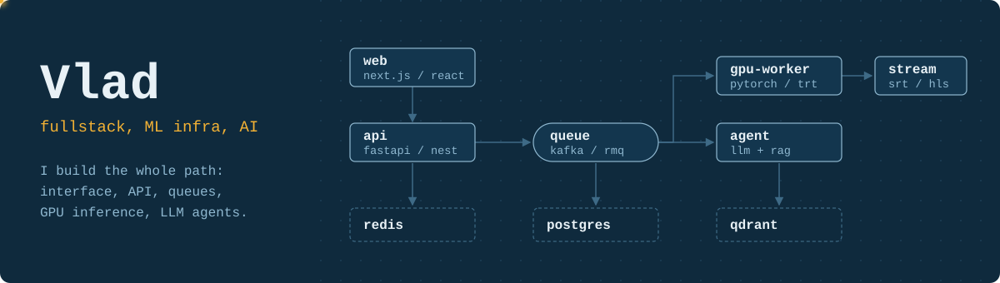

I work across the whole stack. I build product interfaces and APIs, connect services through queues, run models on GPUs in production, and build LLM agents that work on real data. I take a feature from the first schema to the dashboard that shows it running.

### What I work on

<table>
  <tr>
    <th align="left" width="33%">Product</th>
    <th align="left" width="33%">ML in production</th>
    <th align="left" width="33%">AI systems</th>
  </tr>
  <tr valign="top">
    <td>
      Web apps in Next.js and React 
      Services in FastAPI and NestJS 
      Auth: JWT, OAuth2, SSO 
      Real-time over WebSocket
    </td>
    <td>
      GPU inference with PyTorch, ONNX, TensorRT 
      Live video pipelines over SRT and HLS 
      Pose estimation and computer vision 
      Prometheus and Grafana for monitoring
    </td>
    <td>
      LLM agents with tool use 
      RAG on Qdrant 
      Search with reranking 
      Evaluating model output on labelled data
    </td>
  </tr>
</table>

### Stack

<table>
  <tr><td width="140">Web and Node</td><td></td></tr>
  <tr><td>Backend and data</td><td></td></tr>
  <tr><td>ML and AI</td><td> also ONNX, TensorRT, Qdrant, LLM APIs</td></tr>
  <tr><td>Infra</td><td></td></tr>
</table>

### Contact

Open to new roles. Message me on Telegram, that gets the fastest reply.
